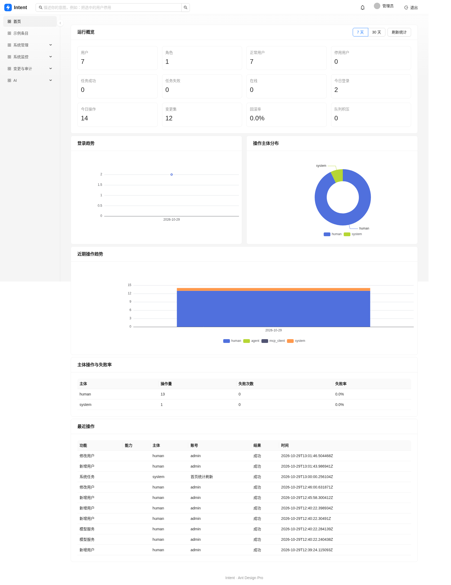
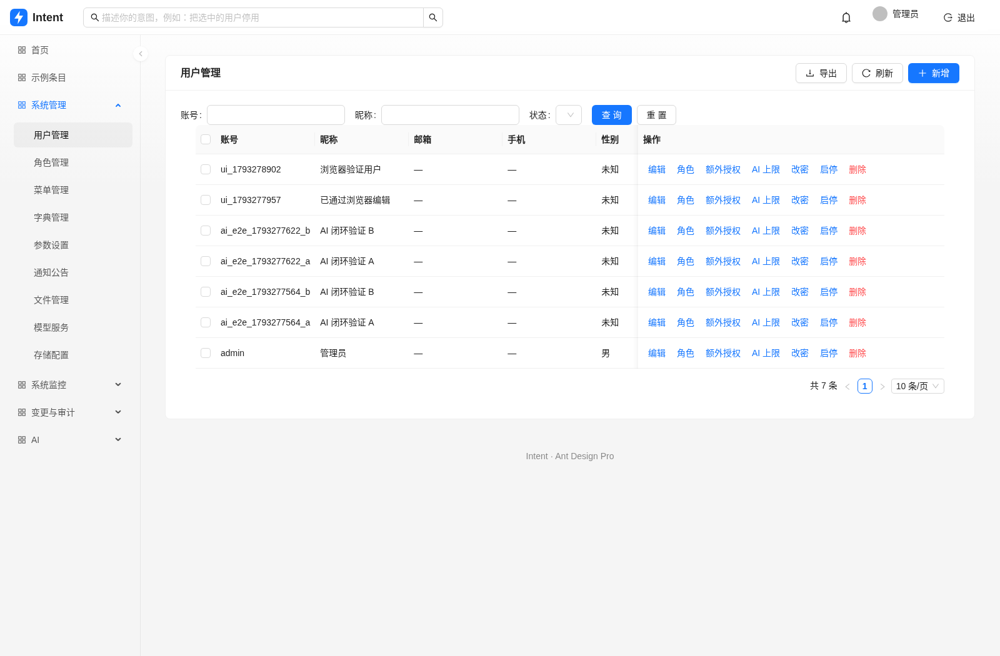
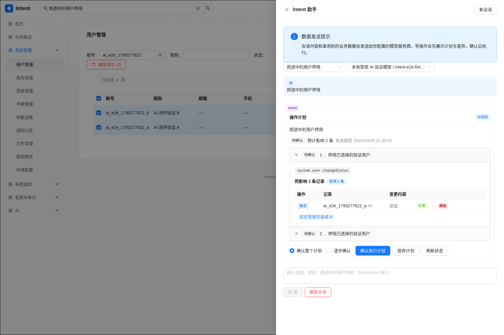

# Intent

[中文](README.md) · English

Intent is an administration system where people and AI use the same typed capabilities. Writes have structured previews, persistent changesets and conflict-aware compensation. Every HTTP, AI and MCP execution passes through the same permission and risk checks.

## Included

- Ant Design Pro v6 / Umi Max interface with dynamic authorized menus, personal profiles and scoped access tokens.
- Users, roles, menus, extra grants, dictionaries, parameters, notices and files.
- Online sessions, login/operation logs, server/cache monitoring, scheduled jobs and asynchronous Excel exports.
- Encrypted model/storage configuration, connection tests, local storage and S3-compatible storage.
- Conversational AI with page context, searchable capabilities, system knowledge, owner-bound persisted plans and stepwise confirmation.
- MCP over Streamable HTTP and stdio, using revocable PATs, trimmed catalogs and one-use write confirmations.
- Atomic business writes and changesets; rollback checks current fields and records its own inverse change.

The backend uses Go, Gin, GORM/PostgreSQL, Redis, Asynq and Goose. The frontend uses React, Ant Design, Pro Components, Umi Max and Zustand. `docs/implementation-plan.md` records the design decisions and phased roadmap.

## Quick start

```sh
git clone https://github.com/junler/intent-admin.git
cd intent-admin
cp .env.example .env
docker compose up --build
```

Open http://localhost:8080 and sign in with `admin` / `123456`. Change the initial password after login. Compose starts PostgreSQL, authenticated Redis, a pinned official MinIO source build, a private bucket initializer, migrations and the application. MinIO's local console is at http://localhost:9001. The Compose credentials are development examples.

For development, install Go 1.26+, Node.js 22+, PostgreSQL 17 and Redis 7:

```sh
cp configs/config.example.yaml configs/config.yaml
# Configure database access and replace the example keys.
make install
make migrate-up
make dev
```

Umi Max serves http://localhost:5173 and proxies the API to port 8080. `make build` embeds the frontend in `bin/intent-admin`; no Node runtime is needed in production. See [CONTRIBUTING.md](CONTRIBUTING.md) for a complete Capability example.

## Configuration and deployment

Configuration precedence is environment variables, the selected YAML file, then defaults. Every field can be set with an `INTENT_ADMIN_` variable, for example `INTENT_ADMIN_DB_PASSWORD` or `INTENT_ADMIN_AI_MAX_RISK`. Generate the signing and encryption keys independently with `openssl rand -base64 32`. Production rejects the example keys. Back up the encryption key with the database: losing it makes encrypted credentials unrecoverable.

Run `intent-admin migrate up` before starting a new version. `migrate seed` fills missing initial menus and settings without replacing existing passwords, settings or edited menus. Use one scheduler per deployment; run additional `worker` processes for queue capacity.

See [deployment details](docs/deployment.md), the Compose file and the Nginx example for streaming, S3 URLs, backups and separate workers. Release tags build six platform archives and two Linux container architectures; they do not deploy an environment.

## AI and MCP

Configure, test, enable and select a model in the model-service page before using AI. The global and user-specific risk ceilings only narrow access; they do not grant permissions. Credential-bearing arguments cannot be persisted in AI plans. Configure model/storage credentials in their dedicated human forms.

Create a personal access token in the account menu. For Streamable HTTP, connect to `http://localhost:8080/mcp` and send `Authorization: Bearer <PAT>`. For local stdio clients:

```json
{
  "mcpServers": {
    "intent": {
      "command": "/path/to/intent-admin",
      "args": ["mcp", "--config", "/path/to/config.yaml"],
      "env": {"INTENT_ADMIN_MCP_TOKEN": "<your-PAT>"}
    }
  }
}
```

The default MCP risk limit is `low`. Write-capable deployments must explicitly choose narrower token scopes and a higher allowed ceiling. A write preview's confirmation token is bound to the actor, capability, resolved arguments and current data, expires, and can be consumed once. Keep PATs in the client's secret store rather than committing them.

## Checks and licenses

Run `make test`, `make test-web`, `make lint` and `make build`. CI also runs PostgreSQL/Redis integration suites for authentication, authorization, plans/rollback, configuration/files, scheduling and asynchronous exports.

Intent is [MIT licensed](LICENSE). Ant Design Pro's upstream license is retained in `web/ANT_DESIGN_PRO_LICENSE`. The optional bundled MinIO service is a separate AGPL-3.0 program built from the pinned upstream source; its license is included in that image.

## Screenshots

The admin frontend is based on [Ant Design Pro](https://github.com/ant-design/ant-design-pro.git). These browser captures use the actual backend; the AI example uses a controlled test model.






