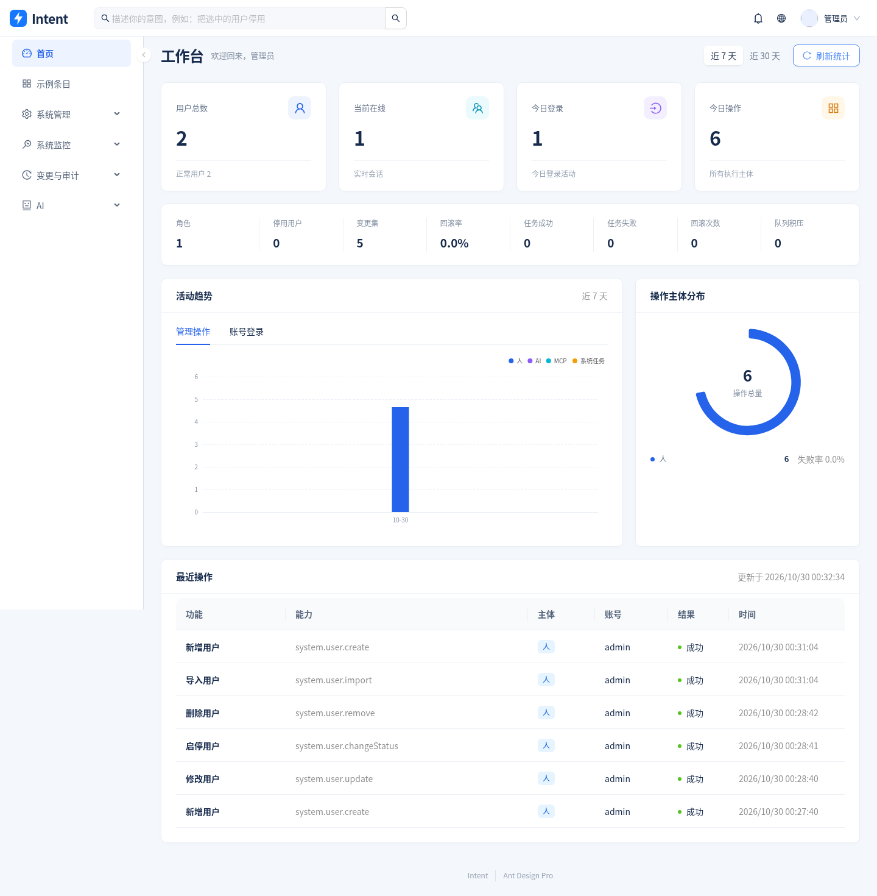
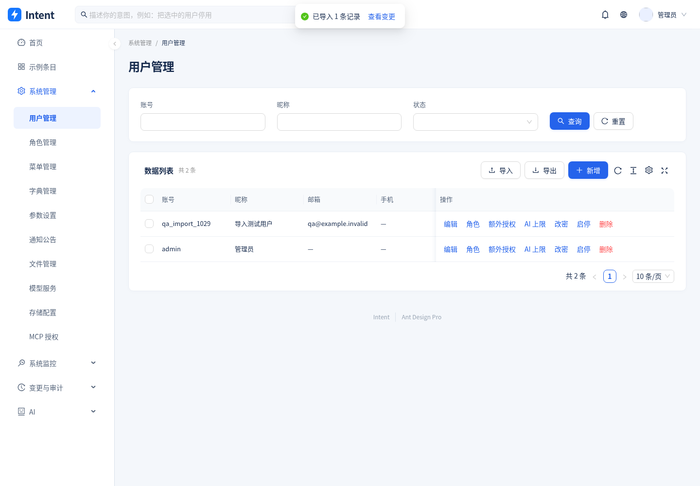
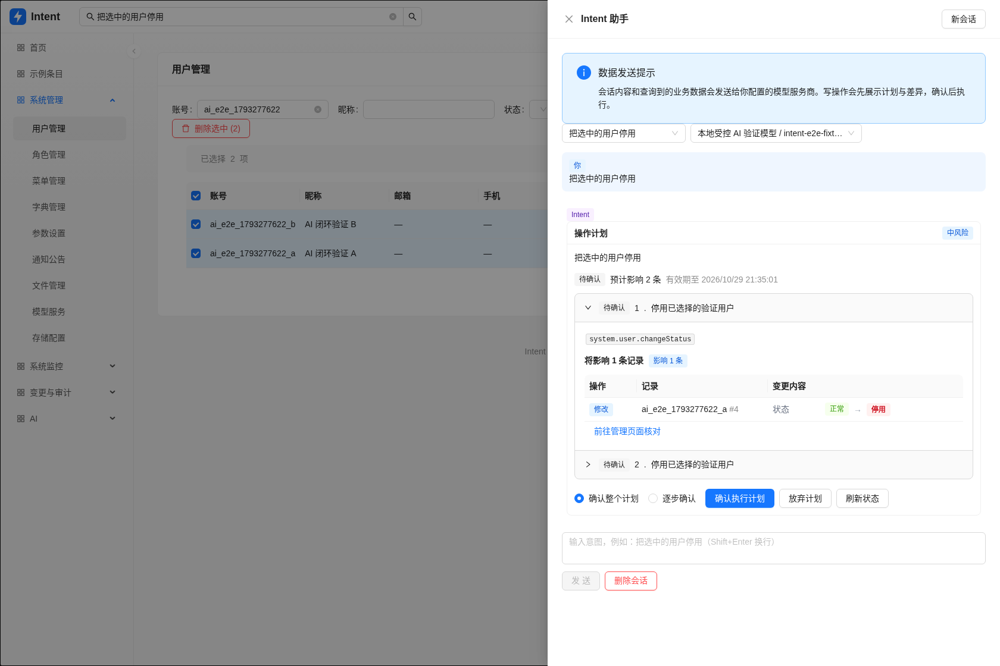

# Intent

[中文](README.md) · English

Intent is an administration system where people and AI use the same typed capabilities. AI writes have structured previews and owner confirmation; human page actions submit directly. Every HTTP, AI and MCP execution passes through the same permission and risk checks.

## Included

- Ant Design Pro v6 / Umi Max interface with dynamic authorized menus, responsive layouts, Chinese/English switching, personal profiles and scoped access tokens.
- Users, roles, menus, extra grants, dictionaries, parameters, notices and files.
- Online sessions, login/operation logs, server/cache monitoring, scheduled jobs, an integrated queue console and asynchronous Excel exports.
- Encrypted model/storage configuration, connection tests, local storage and S3-compatible storage.
- Conversational AI with page context, searchable capabilities, system knowledge, persisted plans and owner confirmation.
- XLSX imports for five entity types, with row validation, error workbooks, previews and atomic confirmation.
- MCP over Streamable HTTP and stdio, using revocable PATs or OAuth authorization, permission-filtered Resources and one-use write confirmations.
- Atomic business writes, version-aware edits, transactional retry receipts and ordinary operation logs.

The backend uses Go, Gin, GORM/PostgreSQL, Redis, Asynq and Goose. The frontend uses React, Ant Design, Pro Components, Umi Max and Zustand. [The implementation plan](docs/implementation-plan.md) records the design decisions and implementation status.

## Quick start

```sh
git clone https://github.com/junler/intent-admin.git
cd intent-admin
cp .env.example .env
docker compose up --build
```

Open http://127.0.0.1:8080 and sign in with `admin` / `123456`. Change the initial password after login. Compose starts PostgreSQL, authenticated Redis, a pinned official MinIO source build, a private bucket initializer, migrations and the application. MinIO's local console is at http://localhost:9001. The Compose credentials are development examples.

For development, install Go 1.26+, Node.js 22+, PostgreSQL 17 and Redis 7:

```sh
cp configs/config.example.yaml configs/config.yaml
# Configure database access and replace the example keys.
make install
make migrate-up
make dev
```

Umi Max serves http://localhost:5173 and proxies the API to port 8080. `make build` embeds the frontend in `bin/intent-admin`; no Node runtime is needed in production. See [CONTRIBUTING.md](CONTRIBUTING.md) for a complete Capability example.

The interface uses the official Ant Design Pro scaffold, ProLayout, ProTable and ProForm, with consistent cards, spacing, responsive tables and navigation. Use the header language picker for Chinese or English. The choice is saved locally; switching follows Umi's normal full-page reload behavior. Translations cover menus, forms, previews, queue controls and known API messages; user-entered business content remains unchanged.

## Import and confirm

The users, roles, parameters, dictionary-data and demo-item pages provide an **Import** action. Download a template, upload one `.xlsx` file, review row errors and the full preview, then confirm the batch. Imports only create new records: existing unique keys are rejected. Each file is limited to 200 data rows and 5 MB, with a lower row limit when configured by `changeset.max_items_per_set`. User imports use the server's initial-password setting and do not accept password or authorization columns. Credential-bearing parameters cannot be imported. A preview belongs to its creator, expires after 10 minutes and is checked again before an atomic commit in one business transaction.


## Queue console

**System monitoring → Queue management** shows this deployment's queues, task details and pending, active, scheduled, retry, archived and completed tasks. Permission-controlled actions provide a preview before retry, archive, cancel, delete, pause or resume. Pausing stops new deliveries while active work continues. Cancellation is a best-effort request and does not undo committed business results. Completed business work cannot be replayed by deleting or retrying its queue record. Internal export identities and payloads remain hidden; export retries recheck the original requester's current permissions.

## Configuration and deployment

Configuration precedence is environment variables, the selected YAML file, then defaults. Every field can be set with an `INTENT_ADMIN_` variable, for example `INTENT_ADMIN_DB_PASSWORD` or `INTENT_ADMIN_AI_MAX_RISK`. Generate the signing and encryption keys independently with `openssl rand -base64 32`. Production rejects the example keys. Back up the encryption key with the database: losing it makes encrypted credentials unrecoverable. Preserve `jwt.secret` too; rotating it invalidates existing browser sessions.

Run `intent-admin migrate up` before starting a new version. `migrate seed` fills missing initial menus and settings without replacing existing passwords, settings or edited menus. Versioned migrations include retained legacy tables, OAuth clients/grants/tokens, private notifications, request receipts and attachment links. Use one scheduler per deployment; run additional `worker` processes for queue capacity.

See [deployment details](docs/deployment.md), the Compose file and the Nginx example for OAuth origins, streaming, S3 URLs, backups and separate workers. Release tags build six platform archives and two Linux container architectures; they do not deploy an environment.

## AI and MCP

Configure, test, enable and select a model in the model-service page before using AI. The global and user-specific risk ceilings only narrow access; they do not grant permissions. Credential-bearing arguments cannot be persisted in AI plans. Configure model/storage credentials in their dedicated human forms.

Create a personal access token in the account menu. For Streamable HTTP, connect to `http://127.0.0.1:8080/mcp` and send `Authorization: Bearer <PAT>`. For local stdio clients:

```json
{
  "mcpServers": {
    "intent": {
      "command": "/path/to/intent-admin",
      "args": ["mcp", "--config", "/path/to/config.yaml"],
      "env": {"INTENT_ADMIN_MCP_TOKEN": "<your-PAT>"}
    }
  }
}
```

For browser-based OAuth 2.1 authorization, set `mcp.oauth_issuer` or `INTENT_ADMIN_MCP_OAUTH_ISSUER` to the application's canonical public origin. The sample is `http://127.0.0.1:8080`; production requires an HTTPS origin such as `https://admin.example.com`. Leaving this setting empty disables OAuth while PAT access continues to work. Clients discover `/.well-known/oauth-protected-resource/mcp` and `/.well-known/oauth-authorization-server`, register as public clients and use the PKCE S256 authorization-code flow. The user logs in and explicitly consents to `mcp:read`, optional `mcp:write` and optional `offline_access`. Refresh tokens rotate, and grants can be revoked from **MCP authorizations**. Read-only grants cannot invoke writes. Existing permissions and risk ceilings still apply.

MCP Resources expose `capability://{name}`, `dict://{type}`, `entity://{table}`, `knowledge://overview`, `knowledge://rules` and `context://me` as JSON. Listings and reads use the current token's permissions and risk limit; permission removal takes effect on the next request, including in a running stdio session.

The default MCP risk limit is `low`. Write-capable deployments must explicitly choose narrow token scopes and a higher allowed ceiling. A write preview's confirmation token is bound to the actor, capability, resolved arguments and current data, expires, and can be consumed once. Keep PATs and OAuth tokens in the client's secret store rather than committing them.

## Checks and licenses

Run `make test`, `make test-web`, `make lint`, `npm --prefix web run i18n:check` and `make build`. CI also runs PostgreSQL/Redis integration suites for authentication, authorization, imports, plan confirmation, internal compensation, OAuth, private notifications, configuration/files, scheduling and queue/export controls. [CONTRIBUTING.md](CONTRIBUTING.md#validation) documents the opt-in integration flags.

Intent is [MIT licensed](LICENSE). Ant Design Pro's upstream license is retained in `web/ANT_DESIGN_PRO_LICENSE`. The optional bundled MinIO service is a separate AGPL-3.0 program built from the pinned upstream source; its license is included in that image.

## Screenshots

The admin frontend is based on [Ant Design Pro](https://github.com/ant-design/ant-design-pro.git). These browser captures use the actual backend; the AI example uses a controlled test model.







## Starting a business project

Run `intent-admin init config --name Orders --config configs/config.yaml`, set
PostgreSQL/Redis connection settings, create an empty database, then run
`intent-admin init database`. Add `--with-demo` for sample menus and rows.
The administrator password is random, written only to a 0600 credential file,
and must be changed on first login. Existing configuration and account tables
are never overwritten. Upgrades use `migrate up` (latest migration: 00012).
Use the existing `scripts/rename.sh` for module/binary/source rebranding.

Shared CRUD editors now submit record versions and transactional idempotency
keys. Business pages can reuse remote selectors, date ranges, upload fields,
master/detail form rows, detail drawers and record-authorized private attachments.
See [template development](docs/template-development.md) and
[deployment](docs/deployment.md) for the contracts and examples.
ordinary operation logs remain available in monitoring.
