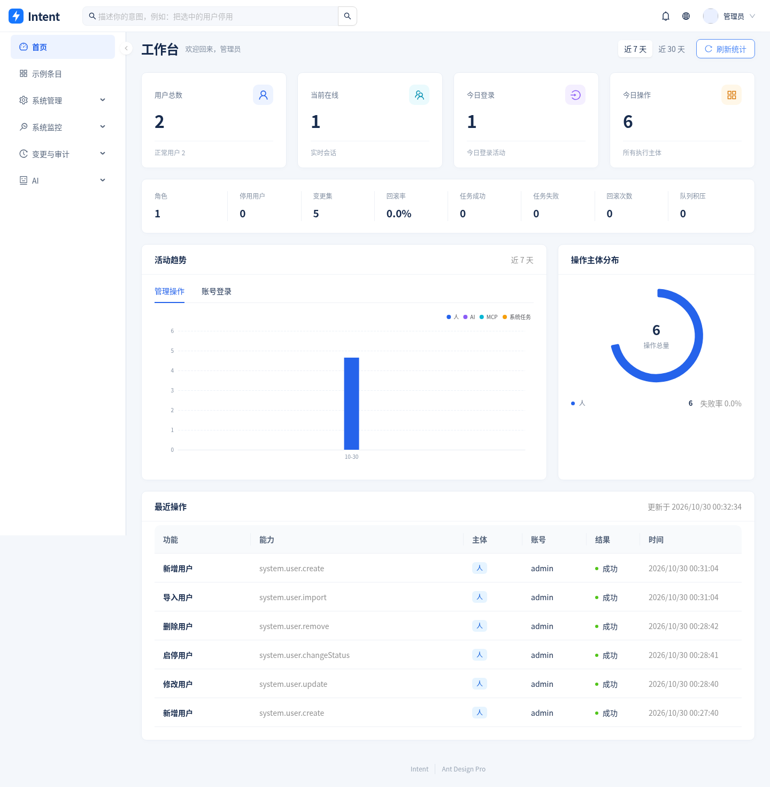
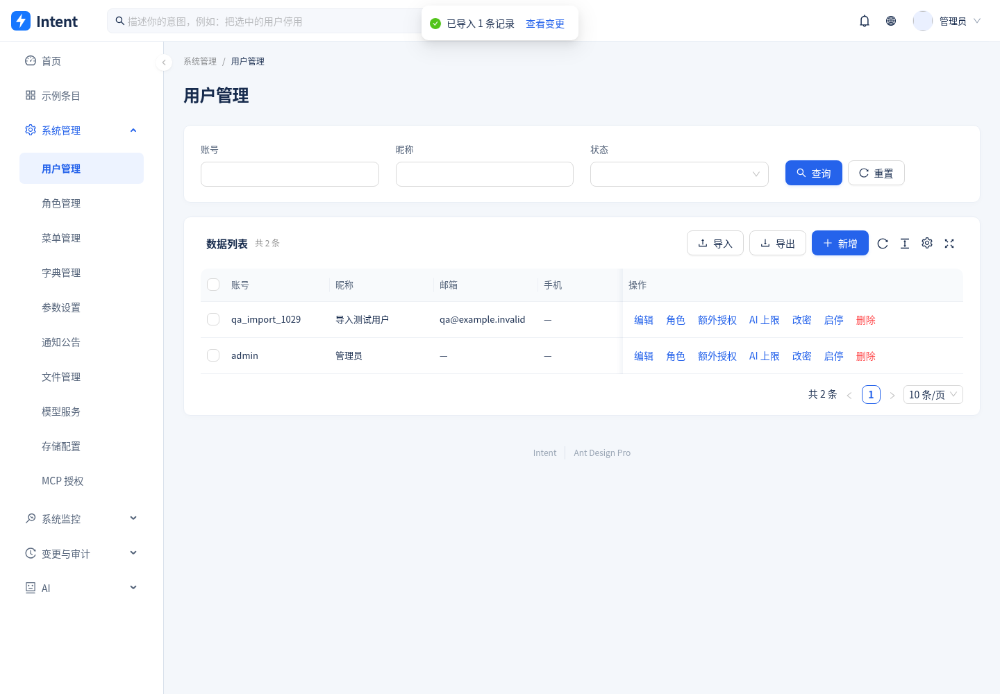
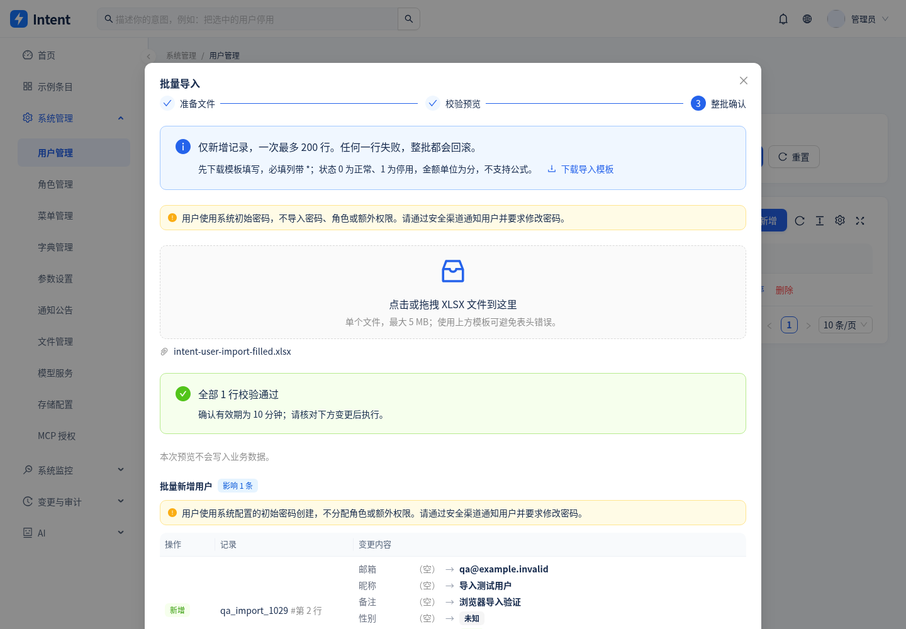
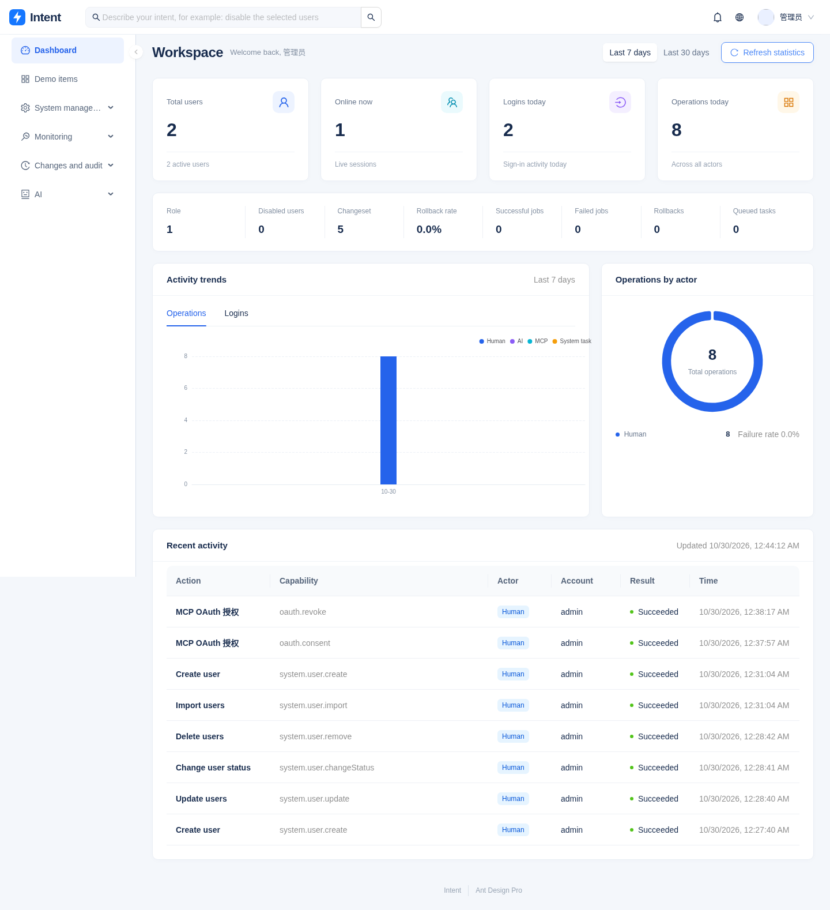

<div align="center">

# Intent

**AI 原生的 Go 后台管理系统。**

人与 AI 双入口等权操作，所有写操作可预览、可追溯、**可一键回滚**。单二进制部署，并可作为 MCP Server 被任意 AI 客户端调用。

[](https://github.com/junler/intent-admin/actions/workflows/ci.yml)
[](https://goreportcard.com/report/github.com/junler/intent-admin)
[](https://pkg.go.dev/github.com/junler/intent-admin)
[](LICENSE)
[](https://github.com/junler/intent-admin/releases)

[English](README.en.md) · 简体中文

</div>

> ⚠️ 本项目处于开发阶段，功能与 API 尚未稳定。完整实施规格见 [`docs/implementation-plan.md`](docs/implementation-plan.md)。

> **v1 功能已接入：** 登录与权限、系统管理、变更历史与回滚、模型与存储配置、文件管理、监控与定时任务、异步导出、知识库、AI 计划和 MCP。前端以官方 [Ant Design Pro](https://github.com/ant-design/ant-design-pro.git) 为基础，采用 Umi Max、ProLayout、ProTable 和 ProForm；所有业务页面连接真实后端。

---

## 为什么又做一个后台框架

因为现在流行的做法是**把一个 AI 对话框塞进 2015 年的后台范式里**，结果是两套互不相干的东西共用一个侧边栏：AI 能聊天但不能真正干活，或者能干活但没人敢让它干。

本项目的前提是反过来的——**先假设 AI 会真的执行操作，再设计让这件事安全可控的系统**。

### 范式对比

| 维度 | 传统 CRUD 后台 | intent-admin |
| --- | --- | --- |
| 主要交互 | 菜单 → 页面 → 搜索表单 → 弹窗表单 | **双入口等权**：页面照旧可用；全局自然语言输入框感知当前页面 |
| 操作单位 | 一次表单提交 = 一个接口调用 | **Plan**：有序多步，整体预览、整体执行、整体回滚 |
| 执行前 | 「确定删除吗？」 | **结构化 diff 预览**：改哪些记录、哪些字段、从什么变成什么、哪些会被跳过 |
| 执行后 | 操作日志记一行 URL | **Changeset**：before/after 快照 + 一键回滚 |
| 权限 | 角色 → 菜单 → 权限串 | 同上，**再叠一层风险等级门槛**：有权限 ≠ 授权 AI 代做 |
| 审计 | 谁调了什么接口 | **行为溯源**：哪个主体（人/AI/外部客户端）、因为什么意图、经过什么审批、改了什么、是否已回滚 |
| AI 的信息来源 | 无 | **系统自省知识库**：字典语义、实体关系、业务规则机器可读注入 |
| 新增一个功能 | 建表 → 写 6 个文件 → 配菜单 | 写一个 **Capability**，自动获得 HTTP 接口 / OpenAPI / AI 能力 / MCP 工具 / Excel 导出 |

### 核心架构

所有业务功能注册为强类型 **Capability**，一次定义，多处可用：

```text
                          ┌──────────────────────┐
         HTTP API ───────▶│                      │
                          │   Capability 注册表   │──▶ 权限 ─▶ 风险门槛 ─▶ 校验
   站内 AI Agent ───────▶│      + 执行器         │      ─▶ 执行 ─▶ Changeset ─▶ 审计
                          │                      │
      MCP Server ───────▶│   （唯一执行路径）     │
                          └──────────────────────┘
                                     │
          自动生成 ◀─────────────────┴──────────────▶ 自动生成
   /preview（diff 预览）                        /export（Excel）
   OpenAPI 3.1 文档                             /template（导入模板）
```

直接结果：

- **AI 不是旁路** —— AI 和 MCP 走同一条权限与审计链路，不存在「接口加了权限、AI 工具忘了加」这类经典漏洞
- **人也受益于可逆性** —— 页面上的删除按钮同样走 preview → changeset，**人类误删一样能一键撤销**
- **工具目录按权限实时裁剪** —— 用户看不到的功能，模型也看不到，不会尝试越权
- **新增功能成本极低** —— 一个 Capability 换来六件事

## 功能特性

### AI 原生

- **全局自然语言输入框**（`Cmd/Ctrl+K`）—— 顶栏常驻，不是侧边栏里的某个「AI 助手」菜单。**感知你当前所在页面**：在用户列表勾选几行说「把这几个停用」，它知道「这几个」是谁
- **三种智能响应** —— 查询直接给答案（带证据链接）；「上周登录失败超 3 次的账号」直接把你带到日志页并**预填筛选条件**（人能验证、能继续操作）；涉及写操作则生成计划卡片
- **Plan → Preview → Apply → Undo** —— AI 产出有序多步计划，每步预演出 diff 与影响面，整体确认后执行，生成可回滚的 changeset
- **AI 无法直接写数据** —— 这是代码结构保证的：Agent 只能 `propose_plan`，写操作的唯一出口是用户确认。不需要「相信模型会守规矩」
- **风险等级门槛** —— 每个功能标 `low/medium/high/critical`。低风险自动执行，高风险必须看 diff，`critical`（删角色、改超管、清空日志）**AI 只能提案，必须人工到页面执行**
- **系统自省知识库** —— 字典语义（`status=0` 是正常）、实体关系、业务规则（超管不可删）机器可读注入，不让模型猜
- **能力浏览器** —— 一个页面列出 AI 到底能对你的系统做什么，含风险等级、所需权限、是否可逆。审计透明，不埋在代码里
- **MCP Server** —— Streamable HTTP + stdio，PAT 鉴权，**默认只读**，写操作需服务端两步确认

### 后台功能

| 分类 | 功能 |
| --- | --- |
| 系统管理 | 用户、角色、菜单、字典、参数、通知公告、文件管理、访问令牌 |
| **模型服务** | **多服务商配置，内置 DeepSeek / 豆包 / 通义 / Kimi / GLM 等预设，选厂商 → 填 Key → 测试 → 启用。Key 加密存储** |
| **存储配置** | **S3 / MinIO 及各家兼容服务（OSS、COS、R2、七牛）后台可配，另保留 local 驱动零依赖可跑** |
| 权限 | 角色授权 + 用户单独加权授权 + AI 风险上限，菜单与按钮级权限，菜单可后台动态增删 |
| **变更与审计** | **变更历史（diff + 一键回滚）**、行为溯源（意图 → 计划 → 变更集链条） |
| 系统监控 | 在线用户（强退）、操作日志、登录日志、服务监控、缓存监控 |
| 任务调度 | 定时任务（cron，后台改动 15s 内生效）、任务日志、队列积压监控 |
| 数据大盘 | 系统指标与趋势，含 **AI 操作占比与回滚率** |
| 导出 | 所有列表一键导出 Excel，筛选条件与页面一致，大数据量自动转后台异步导出 |
| 开发辅助 | 自动生成的 OpenAPI 3.1 + 内置 Swagger UI |

### 工程特性

- **单文件部署** —— 前端构建产物 `embed.FS` 嵌入二进制，部署只需一个文件 + PostgreSQL + Redis
- **单二进制多角色** —— `serve` / `worker` / `mcp` / `migrate` 子命令共用一份代码与配置
- **版本化迁移** —— 嵌入式 SQL，不依赖 `AutoMigrate`
- **配置全可覆盖** —— yaml + `INTENT_ADMIN_*` 环境变量，容器友好

## 技术栈

### 后端

| 用途 | 选型 | 说明 |
| --- | --- | --- |
| 语言 | [Go](https://go.dev/) 1.26+ | Capability 层依赖泛型 |
| Web 框架 | [gin](https://github.com/gin-gonic/gin) | |
| ORM | [GORM](https://gorm.io/) + `driver/postgres` | |
| 数据库 | [PostgreSQL](https://www.postgresql.org/) 14+ | changeset 快照用 `jsonb` |
| 缓存 / 会话 | [Redis](https://redis.io/) 6+ · [go-redis](https://github.com/redis/go-redis) | |
| 异步任务 + 定时调度 | [Asynq](https://github.com/hibiken/asynq) | 队列、worker、重试、唯一性 + 动态定时任务 |
| AI Agent | [Eino](https://github.com/cloudwego/eino) `adk` · [eino-ext](https://github.com/cloudwego/eino-ext) | 字节 CloudWeGo 的 Go LLM 应用框架 |
| MCP | [modelcontextprotocol/go-sdk](https://github.com/modelcontextprotocol/go-sdk) | MCP 官方 Go SDK |
| CLI | [cobra](https://github.com/spf13/cobra) | 单二进制多子命令 |
| 配置 | [viper](https://github.com/spf13/viper) | yaml + 环境变量 |
| Excel 导出 | [excelize](https://github.com/xuri/excelize) | 列表导出与导入模板，大数据量用 StreamWriter |
| 对象存储 | [minio-go](https://github.com/minio/minio-go) | MinIO 与所有 S3 兼容服务 |
| 密钥加密 | 标准库 AES-256-GCM | 加密存储模型 Key 与存储 Secret |
| 数据库迁移 | [goose](https://github.com/pressly/goose) | 嵌入式版本化 SQL |
| JWT | 标准库 HMAC-SHA256 | 签名会话 UUID，Redis TTL 控制到期与吊销 |
| 参数校验 | [validator](https://github.com/go-playground/validator) | 结构体 tag 校验 |
| JSON Schema | [jsonschema-go](https://github.com/google/jsonschema-go) | OpenAPI / AI / MCP 共用 |
| 主机指标 | [gopsutil](https://github.com/shirou/gopsutil) | 服务监控 |
| 验证码 | [base64Captcha](https://github.com/mojocn/base64Captcha) | |
| 日志 | 标准库 `log/slog` | JSON 结构化日志 |
| 密码哈希 | `golang.org/x/crypto/bcrypt` | |

### 前端

| 用途 | 选型 |
| --- | --- |
| Admin 工程 | **[Ant Design Pro](https://github.com/ant-design/ant-design-pro.git) v6**，保留 [MIT 许可](web/ANT_DESIGN_PRO_LICENSE) |
| 构建与运行时 | [Umi Max](https://umijs.org/) v4 · [TypeScript](https://www.typescriptlang.org/) 5+ |
| 后台组件 | [ProComponents](https://procomponents.ant.design/) v3：ProLayout / ProTable / ProForm / PageContainer |
| 框架 | [React](https://react.dev/) 19 |
| UI 组件 | [Ant Design](https://ant.design/) v6 · [@ant-design/icons](https://ant.design/components/icon) |
| CSS | [Tailwind CSS](https://tailwindcss.com/) v4 |
| 路由与权限 | Umi Max 路由、initialState / access，后端菜单驱动的组件注册表 |
| 状态管理 | [zustand](https://github.com/pmndrs/zustand) |
| HTTP | [axios](https://axios-http.com/) |
| 图表 | [ECharts](https://echarts.apache.org/) |
| Markdown | [react-markdown](https://github.com/remarkjs/react-markdown) · remark-gfm |

### 工程与交付

| 用途 | 选型 |
| --- | --- |
| 代码检查 | [golangci-lint](https://golangci-lint.run/) · Biome · TypeScript |
| 测试 | Go `testing` / `httptest` · PostgreSQL / Redis / Asynq 集成测试 · [Vitest](https://vitest.dev/) · Playwright |
| 容器 | Docker 多阶段构建 · distroless 运行镜像 |
| 发布 | [GoReleaser](https://goreleaser.com/) · GitHub Actions · GHCR 多架构镜像 |
| 前端开发 | Umi Max dev server，代理真实 `/api`；npm lockfile |

## 项目结构

```text
intent-admin/
├── main.go                 cobra 入口
├── internal/
│   ├── cli/                serve / worker / mcp / migrate / version
│   ├── capability/         ★ Capability 定义、注册表、执行器、dry-run/undo 助手
│   ├── plan/               ★ Plan 状态机、步骤引用求值、预演、执行
│   ├── changeset/          ★ 变更集落库与回滚引擎
│   ├── knowledge/          ★ 系统自省知识库
│   ├── aiprovider/         ★ 模型服务商预设与 ChatModel 构建
│   ├── storage/            ★ 存储驱动（s3 / local）
│   ├── adapter/
│   │   ├── httpx/            Capability → gin handler + preview/export + OpenAPI
│   │   ├── aitool/           Capability → Eino ADK tool
│   │   └── mcpx/             Capability → MCP tool + PAT 鉴权
│   ├── feature/            按模块注册 Capability
│   ├── service/            业务逻辑（不感知传输层）
│   ├── agent/              Eino ADK 装配、会话、SSE、意图路由
│   ├── task/               Asynq client/server、处理器注册表
│   └── web/                前端产物嵌入（embed.FS）
├── migrations/             版本化 SQL
└── web/                    Ant Design Pro 前端（Umi Max + React + ProComponents）
```

依赖方向严格单向：`feature → capability → service → model`，三个 adapter 只依赖 `capability`。

## 后台界面

前端基于 [Ant Design Pro](https://github.com/ant-design/ant-design-pro.git)，下图来自连接真实后端的浏览器验收。









以上页面连接真实服务。AI 计划验收使用受控测试模型，确认、实际写入、变更记录和回滚均走真实业务链路。

## 快速开始

### 本地开发

前置：Go 1.26+、Node.js 22+、npm、PostgreSQL 14+、Redis 6+。先启动 PostgreSQL 和 Redis。

```bash
cp configs/config.example.yaml configs/config.yaml
# 编辑 db.*、redis.*、jwt.secret 和 app.encrypt_key，保持 app.env=dev。
# 已有本地配置时保留原文件。当前无需配置模型 API Key。

createdb -h 127.0.0.1 -U postgres intent_admin

make install
make migrate    # 建表，写入管理员、当前菜单、字典、参数和演示数据
make dev        # 后端 :8080 + 前端 :5173（自动代理 /api）
```

打开 http://localhost:5173，进入 Ant Design Pro 登录页，使用初始账号 `admin` / `123456` 和图形验证码登录。登录后进入首页大盘。侧边栏由有效权限派生，各管理页可筛选、分页、导出、预览后启用/停用或删除条目。能力浏览器展示自动生成的接口目录。首次登录后请进入右上角个人中心修改初始管理员密码。个人中心也提供头像和访问令牌管理入口。

健康检查：http://localhost:8080/healthz；API 文档：http://localhost:8080/swagger；OpenAPI：http://localhost:8080/openapi.json。

开发和生产环境均需要登录。验证码默认开启，公开注册默认关闭，由 `sys_config` 中的 `sys.account.captchaEnabled` / `sys.account.registerUser` 控制；注册账号不自动获得角色或权限。`migrate seed` 可补齐缺失的种子数据，保留已有密码、设置和菜单。迁移会初始化完整后台菜单和操作权限。

JWT 携带签名后的会话 UUID，由 Redis `login_token:{uuid}` 的 TTL 控制有效期；JWT 不另设固定 `exp`，以支持刷新时保持原 token。剩余 TTL 少于 `jwt.expire` 的三分之一时，`POST /api/refreshToken` 延长会话；删除对应 Redis key 后立即返回 401。权限快照缓存 30 分钟，后续角色、菜单和用户授权写入必须调用 `InvalidatePermissions`。浏览器操作的风险上限为 critical，AI/MCP 仍受全局和主体风险上限限制。

同账号密码连续错误 5 次锁定 10 分钟；登录/注册按 IP 共用每分钟 20 次限额，验证码每分钟 60 次。默认不信任转发 IP 头；反向代理部署时按连接地址限流。`serve` 内嵌 worker 与动态调度器；`worker` 可独立部署，`mcp` 提供 stdio 接入，`migrate rekey` 可事务性轮换数据库中的模型和存储密钥。

`make test` 运行 Go 单元测试，`npm --prefix web test` 运行前端测试。真实 PostgreSQL/Redis 集成测试需使用以 `_integration` 结尾的独立测试数据库：

```bash
INTENT_ADMIN_INTEGRATION=1 \
INTENT_ADMIN_DB_NAME=intent_admin_integration \
go test ./internal/bootstrap -run TestAuthenticationIntegration -v
```

数据库与 Redis 的其他连接参数可通过 `INTENT_ADMIN_DB_*`、`INTENT_ADMIN_REDIS_*` 覆盖。集成测试会迁移测试数据库，并使用独立 Redis key 前缀，覆盖验证码、登录/注册、权限 403、会话刷新/吊销及风险 423。

### Ant Design Pro 前端

前端目录为 [`web/`](web/)，工程基于官方 Ant Design Pro v6（上游提交 `42f2cb1d303380909ea04c73b5e60679d09c321a`）改造。`config/config.ts` 管理 Umi Max 配置，`src/app.tsx` 接入真实登录态与 ProLayout，`src/access.ts` 定义权限，页面使用 ProTable / ProForm。构建时生成组件注册表，运行时只加载后端授权的菜单页面。

```bash
cd web
npm ci              # 安装并生成 Umi 运行时代码
npm run dev         # http://localhost:5173，API 代理至 :8080
npm run typecheck
npm test
npm run build       # 生成 dist/ 与 gzip 静态资源
```

主要页面：大盘；用户、角色、菜单、字典、参数、公告；个人中心与令牌；模型服务、存储配置、文件；在线用户、日志、缓存、服务监控、定时任务；变更历史与行为溯源；AI 会话、跨人审批、队列控制台、MCP 客户端授权和能力浏览器。右上角可切换中文或英文，语言选择会保留；切换时按 Umi 默认行为重新加载页面。顶栏全局输入框支持 `Cmd/Ctrl+K`，并携带当前筛选与选中项。

### 单二进制构建

```bash
make build        # 构建前端 → 嵌入 → 编译
make serve        # 启动 :8080，直接提供前端和 API
```

打开 http://localhost:8080。产物 `bin/intent-admin` 已包含前端资源；运行时仍需配置文件（或环境变量）、PostgreSQL 和 Redis。

### Docker Compose

```bash
cp .env.example .env
# 编辑数据库、Redis、MinIO 密码，以及 JWT_SECRET / ENCRYPT_KEY。
docker compose up --build -d
```

打开 http://localhost:8080。Compose 包含 PostgreSQL、Redis、从固定源码构建的 MinIO、桶初始化、迁移和应用。MinIO 公网地址与应用公网地址可分别配置，私有文件使用预签名链接；已有部署的存储配置不会被引导参数覆盖。

### 接入模型并走通操作链路

1. 进入「系统管理 → 模型服务」，选择 DeepSeek、火山方舟、通义、OpenAI 等预设，填写 Key 与模型并保存。
2. 对已保存配置执行连通性测试，确认支持工具调用后启用并设为默认。错误 Key、工具调用不支持、网络不可达会分别提示。
3. 在用户列表选中记录，通过顶栏描述操作；检查计划与 diff 后确认。可在「变更历史」查看影响字段和撤销操作。
4. 在计划卡片选择「申请他人审批」，指定拥有审批和原操作权限的账号；对方在审批中心核对差异后批准，由发起人执行。审批后数据或权限变化会要求重新确认。
5. 在「存储配置」测试本地或 S3 / MinIO 配置，启用后可在文件管理上传；`presigned` 模式按原存储配置生成临时链接。

实际模型调用需要你自己的服务商凭证。自动化测试使用受控的模型接口和 Eino ADK stub，不会消耗真实模型额度。

### 批量导入与选择性回滚

用户、角色、参数、字典数据及示例条目页面提供「导入」。下载模板后上传 xlsx，检查每行校验、错误报告及差异预览，再确认整批写入。每次最多 200 行、文件不超过 5 MB，并受变更集条数配置限制。导入仅创建新记录；用户初始密码取服务端配置，不接受密码列；凭据类参数禁止导入。确认有效期为 10 分钟，数据变化后需重新预览。

变更集详情可勾选条目回滚，查看逐项冲突与回滚链接。属于同一原子补偿组的条目会一起选择；部分回滚后可继续处理其余记录，也可撤销已产生的回滚变更集。

### 队列控制与 OAuth

「系统监控 → 队列管理」展示各队列及待处理、执行中、延迟、重试、归档和完成任务。操作必须拥有对应权限并确认预览；取消为尽力取消，已完成的业务结果不能通过重试再次执行。内部导出任务的身份与载荷保持隐藏。

配置 `mcp.oauth_issuer`（环境变量 `INTENT_ADMIN_MCP_OAUTH_ISSUER`）为应用的规范公开 origin，例如 `https://admin.example.com`。本地开发可用 `http://127.0.0.1:8080`；留空仅关闭 OAuth，PAT 接入继续可用。客户端通过 `/.well-known/oauth-protected-resource/mcp` 和 `/.well-known/oauth-authorization-server` 发现服务，动态注册并使用 PKCE S256 授权码流程。用户登录后显式确认 scope，可在「MCP 授权」中随时撤销；读权限始终不能调用写操作。

MCP Resources 提供当前账号可访问的功能描述、字典、实体知识及本人上下文；每次读取重新鉴权，权限收回立即生效。

## 配置

默认读 `configs/config.yaml`，可用 `--config` 指定。所有项支持 `INTENT_ADMIN_` 前缀环境变量覆盖（嵌套用 `_` 连接，如 `INTENT_ADMIN_DB_PASSWORD`）。

完整示例见 [`configs/config.example.yaml`](configs/config.example.yaml)。关键项：

| 配置 | 默认 | 说明 |
| --- | --- | --- |
| `jwt.secret` | — | **必填**，为空时拒绝启动 |
| `app.encrypt_key` | — | **必填**，32 字节。加密模型 Key 与存储 Secret。**丢失则库里的密钥全部不可恢复，务必随数据库一起备份** |
| `ai.bootstrap.*` / `storage.bootstrap.*` | — | 仅用于首次部署引导；实际配置在后台「模型服务 / 存储配置」页面维护 |
| `ai.max_risk` | `high` | AI 可执行的风险上限。设 `critical` 会在启动时告警 |
| `ai.max_affected` | `200` | 单个 Plan 影响条数上限，超出强制人工执行 |
| `mcp.max_risk` | `low` | **默认只读**。调高前请读「安全说明」 |
| `changeset.retain_days` | `90` | 变更历史保留天数 |
| `export.max_rows` | `50000` | 同步导出上限，超出转后台异步导出 |
| `task.scheduler` | `true` | 是否内嵌定时任务调度器。多副本部署**只能有一个副本为 true** |

## CLI

```bash
intent-admin serve                          # HTTP 服务（含 MCP Server）
intent-admin worker --concurrency 20        # 独立 Asynq worker，可多副本
intent-admin mcp                            # stdio 传输的 MCP Server
intent-admin migrate up|down|status|seed    # 数据库迁移
intent-admin version
```

## MCP 接入

生成访问令牌：登录后台 → 个人中心 → 访问令牌 → 新建（明文只显示一次）。

远程接入（Streamable HTTP）：

```json
{
  "mcpServers": {
    "intent-admin": {
      "type": "http",
      "url": "https://your-domain.com/mcp",
      "headers": { "Authorization": "Bearer iadm_xxxxxxxx" }
    }
  }
}
```

本地接入（stdio）：

```json
{
  "mcpServers": {
    "intent-admin": {
      "command": "intent-admin",
      "args": ["mcp", "--config", "/path/to/config.yaml"],
      "env": { "INTENT_ADMIN_MCP_TOKEN": "iadm_你的个人访问令牌" }
    }
  }
}
```

**写操作默认不可用**。要开启需同时满足三个条件：`mcp.max_risk` 调高、令牌 `scopes` 覆盖对应权限、客户端完成服务端的两步确认（第一次调用只返回 diff 预览和 `confirmToken`，再调一次 `confirm_plan` 才真正执行；参数在两步之间被改会被拒绝）。

## 安全说明

部署前请通读：

- **AI 与 MCP 都会把数据发给模型服务商** —— Agent 查询到的业务数据与会话内容会发送到你配置的模型服务。请据此选择服务商，并谨慎授予 `ai:agent:use`（默认只给超管角色）。
- **`mcp.max_risk` 默认 `low` 是有意的** —— 调高后持有令牌的外部 AI 客户端可以修改你的数据。服务端两步确认降低了风险但不消除。建议只在受控环境开启，并用令牌 `scopes` 与 `max_risk` 收窄范围。
- **站内 AI 的写操作始终需要人工确认** —— 这不可通过配置关闭。Agent 在代码层面没有直接写数据的路径。
- **`critical` 操作 AI 永远不能执行** —— 删角色、改超管、清空日志、修改权限只能人工在页面完成。
- **`jwt.secret` 和 `app.encrypt_key` 必须备份** —— 模型 API Key 与存储 Secret 用它加密后存库。密钥丢失则这些凭证全部不可恢复，只能重新填一遍。轮换用 `intent-admin migrate rekey --old-key=...`（需旧钥在手）。凭证回滚使用按保留期到期的 Redis 加密补偿记录，依赖 `jwt.secret`；轮换 JWT secret 会使已有会话及这类补偿记录失效。
- **模型服务与存储配置不对 AI 开放** —— 这是硬约束，启动时有自检强制。原因：这两处含 `base_url` / `endpoint`，一旦 AI 能改，一次提示注入就能把全部会话数据与上传文件导向攻击者的服务器，而系统表面上毫无异常。
- **访问令牌是提权面** —— 明文只在创建时显示一次，库中只存 SHA-256；令牌管理功能本身不通过 MCP 暴露。
- **回滚不是时光机** —— changeset 回滚只还原本次变更涉及的字段，不能撤销级联影响。
- **超管账号受硬保护** —— 不可删除、停用，不可被非超管修改。
- **生产环境请修改默认密码**，并为 `jwt.secret` 使用足够随机的值。

发现安全问题请按 [SECURITY.md](SECURITY.md) 私下报告，不要开公开 issue。

## 路线图

- [x] Capability 层、权限与风险门槛
- [x] Changeset 与一键回滚
- [x] 系统管理、监控、审计、定时任务
- [x] 知识库、Plan、AI Agent、Omnibox
- [x] MCP Server（HTTP + stdio）
- [x] 模型服务与存储配置（后台可配 + 密钥加密）
- [x] 大盘、文件管理、Excel 导出
- [x] 单二进制打包与发布流程

扩展功能也已接入：

- [x] 批量导入（xlsx，逐行校验、错误报告、整体预览、原子提交与整批回滚）
- [x] 界面中英文切换（菜单、表单、预览、审批和提示）
- [x] Plan 跨人审批（指派、待办、批准、驳回、撤销与重新审批）
- [x] MCP OAuth 2.1（PKCE、授权确认、轮换与撤销）及权限裁剪的 Resources
- [x] 选择性回滚（条目选择、原子补偿组、冲突检查与反向恢复）
- [x] 队列控制台（任务详情、重试、归档、取消、删除、暂停与恢复）

## 贡献

欢迎 Issue 与 PR。开始前请读 [CONTRIBUTING.md](CONTRIBUTING.md)，其中**「新增一个 Capability」**一节值得先看——本项目新增功能只需定义一个 Capability 即可同时获得 HTTP 接口、AI 能力、MCP 工具、diff 预览、Excel 导出。

提 PR 时请在说明里写清新增 Capability 的 **Risk 等级依据**——这是本项目的安全边界，静态检查无法替代人工 review。

参与本项目需遵守 [行为准则](CODE_OF_CONDUCT.md)。

## 致谢

感谢这些项目，没有它们本项目不可能存在：

[Eino](https://github.com/cloudwego/eino) · [MCP Go SDK](https://github.com/modelcontextprotocol/go-sdk) · [gin](https://github.com/gin-gonic/gin) · [GORM](https://gorm.io/) · [Asynq](https://github.com/hibiken/asynq) · [cobra](https://github.com/spf13/cobra) · [viper](https://github.com/spf13/viper) · [lancet](https://github.com/duke-git/lancet) · [excelize](https://github.com/xuri/excelize) · [minio-go](https://github.com/minio/minio-go) · [goose](https://github.com/pressly/goose) · [React](https://react.dev/) · [Ant Design](https://ant.design/) · [Tailwind CSS](https://tailwindcss.com/) · [Ant Design Pro](https://pro.ant.design/) · [Umi](https://umijs.org/) · [ProComponents](https://procomponents.ant.design/)

## License

[MIT](LICENSE) © intent-admin contributors
